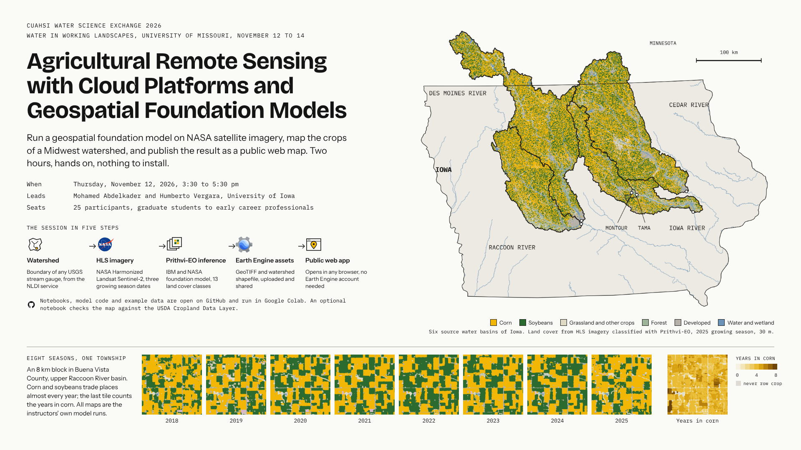

# Agricultural Remote Sensing with Cloud Platforms and Geospatial Foundation Models

Hands-on materials for a two-hour workshop at the CUAHSI Water Science Exchange 2026, *Water in Working Landscapes*, University of Missouri, Columbia, Missouri.



Participants pick a watershed, retrieve NASA Harmonized Landsat Sentinel-2 imagery over it, run an open geospatial foundation model from the IBM and NASA Prithvi family, and publish the resulting crop map as a Google Earth Engine App. Everyone leaves with a crop map they produced themselves and a link to it that opens in any browser. The whole session runs in Google Colab, so there is nothing to install.

## Workshop at a glance

| | |
|---|---|
| Event | [CUAHSI Water Science Exchange 2026, Water in Working Landscapes](https://www.cuahsi.org/events/cuahsi-water-science-exchange-water-in-working-landscapes), University of Missouri, November 12 to 14, 2026 |
| Session | Thursday, November 12, 2026, 3:30 to 5:30 pm |
| Format | Two hours, hands on, all computation in Google Colab and Google Earth Engine |
| Leads | Mohamed Abdelkader and Humberto Vergara, IIHR Hydroscience and Engineering, University of Iowa |
| Capacity | 25 participants |
| Audience | Graduate students, postdoctoral researchers and early career professionals with hydrologic or environmental training and limited formal remote sensing background |
| Registration | [Event registration](https://web.cvent.com/event/6d152f5f-5181-4be3-98ae-0112477ef4b5/summary) through CUAHSI |

## Quick start

1. **Create three free accounts** before the session: a Google account, a NASA Earthdata Login, and a Google Earth Engine project. The checklist is in [docs/setup_accounts.md](docs/setup_accounts.md).
2. **Open notebook 1 in Google Colab** with the badge below and run the cells from top to bottom. Continue with notebooks 2 and 3. How Colab works is explained in [docs/google_colab.md](docs/google_colab.md).
3. **Publish your map** by following [GEE/README.md](GEE/README.md): upload two files to Google Earth Engine, paste one script, publish an app.

## The notebooks

Run them in order. Each notebook saves its results in a folder of your Google Drive named `cuahsi_crop_map`, and the next notebook reads them from there.

| | Notebook | What happens | Time | Open |
|---|---|---|---|---|
| 1 | Pick a basin | Get a watershed boundary from the USGS for any stream gauge, check it against the published drainage area, map it | 15 min | [](https://colab.research.google.com/github/gomezvelezlab/nasa-nfews-iihr-public/blob/main/workshops/2026-cuahsi-agricultural-remote-sensing/notebooks/01_pick_a_basin.ipynb) |
| 2 | From raw imagery to a crop map | Search HLS imagery, screen cloud cover and tile coverage, download, inspect, stack 18 bands, run Prithvi-EO, save a georeferenced crop map | 45 min | [](https://colab.research.google.com/github/gomezvelezlab/nasa-nfews-iihr-public/blob/main/workshops/2026-cuahsi-agricultural-remote-sensing/notebooks/02_imagery_and_crop_map.ipynb) |
| 3 | Visualize and export | Read the map against its imagery, land cover statistics, an interactive web map, a cloud optimized GeoTIFF and a watershed shapefile | 20 min | [](https://colab.research.google.com/github/gomezvelezlab/nasa-nfews-iihr-public/blob/main/workshops/2026-cuahsi-agricultural-remote-sensing/notebooks/03_visualize_and_export.ipynb) |
| 4 | Check against the Cropland Data Layer (optional) | Compare the map with the USDA Cropland Data Layer in Google Earth Engine, class by class | 15 min | [](https://colab.research.google.com/github/gomezvelezlab/nasa-nfews-iihr-public/blob/main/workshops/2026-cuahsi-agricultural-remote-sensing/notebooks/04_check_against_cdl.ipynb) |

Every notebook states at most four learning objectives at the top, comments the critical steps, and ends with a short guided activity: a cell with `...` placeholders to fill in, followed by a collapsed solution.

The first cell of every notebook copies this repository to the Colab machine, installs the few packages that Colab does not already have, connects Google Drive, and prints the hardware it found. Notebook 2 runs faster on a GPU: choose *Runtime*, *Change runtime type*, *T4 GPU* before running it.

## Sharing the map: the `GEE` folder

A map that stays on a laptop reaches nobody. The [`GEE`](GEE/) folder shows the simplest way to put a result online.

| In the folder | What it is |
|---|---|
| [`GEE/README.md`](GEE/README.md) | Step by step instructions: upload a GeoTIFF and a shapefile to Google Earth Engine, paste the script, publish the app |
| [`GEE/crop_map_app.js`](GEE/crop_map_app.js) | The script to copy and paste into the Earth Engine Code Editor. It draws the crop map, the watershed boundary, a legend, and a click inspector |
| [`GEE/data/south_fork_crop_map_2023.tif`](https://github.com/gomezvelezlab/nasa-nfews-iihr-public/raw/main/workshops/2026-cuahsi-agricultural-remote-sensing/GEE/data/south_fork_crop_map_2023.tif) (click to download) | The crop map displayed by the app: South Fork Iowa River basin, Iowa, 2023 growing season |
| [`GEE/data/south_fork_watershed.zip`](https://github.com/gomezvelezlab/nasa-nfews-iihr-public/raw/main/workshops/2026-cuahsi-agricultural-remote-sensing/GEE/data/south_fork_watershed.zip) (click to download) | The watershed boundary as a zipped shapefile, uploaded as it is (also provided unzipped and as GeoJSON) |

The steps work with the example files or with the two files that notebook 3 produces for any other basin.

## Session plan

| Time | Part | Material |
|---|---|---|
| 3:30 | Welcome, account check, why land cover matters for water | Slides |
| 3:45 | Pick a basin | Notebook 1 |
| 4:00 | Imagery, clouds, the foundation model, inference | Notebook 2 and slides |
| 4:45 | Read the map, export it | Notebook 3 |
| 5:05 | Publish the map as an Earth Engine App | `GEE` folder |
| 5:20 | Agreement with the Cropland Data Layer, discussion, next steps | Slides, notebook 4 for those who wish to continue |

## Learning outcomes

By the end of the session participants will be able to

1. describe how harmonized satellite imagery is structured as input to a geospatial foundation model, including band composition and growing season time steps;
2. run inference with a pretrained geospatial foundation model to produce a crop type map from harmonized satellite imagery;
3. assess classification agreement against independent reference labels and report it per class;
4. ingest a raster product as a Google Earth Engine asset and configure its sharing permissions;
5. publish the result as an interactive web map that opens without an Earth Engine account.

## Before the session

Account registration is the usual source of delay in a hands-on session. Please complete [docs/setup_accounts.md](docs/setup_accounts.md) before November 12.

| Account | Why | Guide |
|---|---|---|
| Google account | Google Colab runs the notebooks, Google Drive keeps your results | [docs/google_colab.md](docs/google_colab.md) |
| NASA Earthdata Login | Downloading HLS imagery in notebook 2 | [docs/setup_accounts.md](docs/setup_accounts.md), <https://urs.earthdata.nasa.gov> |
| Google Earth Engine, registered for noncommercial use | Publishing the map, and the optional notebook 4 | [docs/google_earth_engine_account.md](docs/google_earth_engine_account.md) |

Bring a laptop with a current web browser and a charger. A GitHub account is not needed.

## What the default run produces

With the default settings (South Fork Iowa River NE of New Providence, Iowa, USGS gauge 05451210, 2023 growing season) and the whole basin selected, the instructors obtained the map shipped in `GEE/data`:

| | |
|---|---|
| Basin area | 583 km<sup>2</sup> from the boundary polygon, 580 km<sup>2</sup> published by the USGS |
| Imagery | HLS S30 scenes of May 1, July 10 and September 8, 2023, on tiles T15TVG and T15TVH |
| Corn | 55 percent of the basin |
| Soybeans | 30 percent of the basin |
| Agreement with the USDA Cropland Data Layer 2023 | 86 percent of pixels. Corn: 95 percent (producer's) and 93 percent (user's). Soybeans: 94 percent and 89 percent |
| Weakest class | Natural vegetation (grassland and pasture): the map finds about a third of what the Cropland Data Layer labels as such |

The agreement values were computed with the method of notebook 4 and the crosswalk in `wsrs/classes.py`. They describe consistency with another map, not accuracy against field observations.

## Data and model sources

Everything used in the notebooks is open. Please keep these attributions when you reuse the outputs.

| Source | Used for | Provider and access | License and citation |
|---|---|---|---|
| Harmonized Landsat Sentinel-2, S30 collection, version 2.0 | Model input: six bands at three growing season dates | NASA LP DAAC, searched and downloaded through the `earthaccess` library with a free Earthdata Login | NASA open data. Cite: Masek, J., Ju, J., Roger, J., Skakun, S., Vermote, E., Claverie, M., Dungan, J., Yin, Z., Freitag, B., and Justice, C. (2021). *HLS Sentinel-2 Multi-spectral Instrument Surface Reflectance Daily Global 30m v2.0*. NASA EOSDIS Land Processes DAAC. https://doi.org/10.5067/HLS/HLSS30.002 |
| Prithvi-EO-1.0-100M multi-temporal crop classification model | Inference, 13 land cover classes at 30 m | IBM and NASA, weights downloaded from Hugging Face at run time | Apache 2.0. Cite: Li, H., Khallaghi, S., Cecil, M., Kordi, F., Fraccaro, P., Alemohammad, H., and Ramachandran, R. (2023). *HLS Multi Temporal Crop Classification Model*. https://doi.org/10.57967/hf/0954. Foundation model: Jakubik, J. et al. (2023). *Foundation Models for Generalist Geospatial Artificial Intelligence*. arXiv:2310.18660 |
| HLS multi-temporal crop classification training dataset | Not downloaded by the notebooks. Cited because the model's classes and normalization constants come from it | Clark University Center for Geospatial Analytics, IBM and NASA, on Hugging Face | CC BY 4.0. Cite: Cecil, M., Kordi, F., Li, H., Khallaghi, S., and Alemohammad, H. (2023). *HLS Multi Temporal Crop Classification*. https://doi.org/10.57967/hf/0955 |
| USDA NASS Cropland Data Layer | Reference labels for the agreement assessment in notebook 4 | USDA National Agricultural Statistics Service, read in Google Earth Engine as `USDA/NASS/CDL` | Public domain. Cite: USDA National Agricultural Statistics Service Cropland Data Layer (year used), https://www.nass.usda.gov/Research_and_Science/Cropland/ |
| USGS Network Linked Data Index and National Water Information System | Watershed boundary, drainage area, river network and gauge list in notebook 1 | USGS water data web services, no account | Public domain |
| Google Earth Engine | Hosting the two assets and the public app, and access to the Cropland Data Layer in notebook 4 | Google, Cloud project registered for noncommercial use | Google Earth Engine terms of service |
| Basemaps in the interactive maps of notebooks 1 and 3 | Background satellite imagery and topographic map | Esri World Imagery; USGS The National Map (USGSTopo) | Esri attribution required. The National Map is in the public domain |
| Example data in `GEE/data` | Crop map and watershed boundary used in the publishing exercise | Produced by the instructors with notebooks 1 to 3 from the sources above | CC BY 4.0 |
| Figures in `docs/figures/` | Workshop banner and the Iowa basins map | Produced by the instructors from their own Prithvi-EO runs over NASA HLS imagery, 2018 to 2025 | CC BY 4.0 |

## The model

[Prithvi-EO-1.0-100M multi-temporal crop classification](https://huggingface.co/ibm-nasa-geospatial/Prithvi-EO-1.0-100M-multi-temporal-crop-classification) is a temporal Vision Transformer. The underlying foundation model was pretrained by IBM and NASA on Harmonized Landsat Sentinel-2 imagery, and this version was then fine-tuned on USDA Cropland Data Layer labels over the contiguous United States.

- input: 6 bands at 3 growing season dates, 224 by 224 pixels at 30 m
- output: 13 land cover classes
- size of the fine-tuned network: about 140 million parameters, of which 44 million are in the encoder. The "100M" in the name refers to the pretrained foundation model

`wsrs/model.py` reimplements the published architecture in plain PyTorch and loads the released weights unchanged, so that `pip install torch` is the whole setup. The official inference code depends on the legacy mmcv and mmsegmentation stack, which is difficult to install on a managed cloud runtime. All 112 checkpoint tensors load with no missing or unexpected keys.

Classes: 1 Natural Vegetation, 2 Forest, 3 Corn, 4 Soybeans, 5 Wetlands, 6 Developed/Barren, 7 Open Water, 8 Winter Wheat, 9 Alfalfa, 10 Fallow/Idle Cropland, 11 Cotton, 12 Sorghum, 13 Other. Value 0 is no data.

## Repository layout

```
README.md                  this page
requirements.txt           Python dependencies (minimum versions, no pins)
notebooks/                 the four notebooks, opened in Google Colab
src/                       the same notebooks as plain Python, jupytext percent format
wsrs/                      helper package, documented and meant to be read
  basin.py                 USGS NLDI and NWIS: watershed boundaries, gauges, shapefile export
  classes.py               the 13 land cover classes, their colors, the Cropland Data Layer crosswalk
  hls.py                   HLS search, cloud and coverage screening, download, 18 band stacking
  model.py                 Prithvi-EO-1.0-100M crop classifier in plain PyTorch
  viz.py                   colors, legends, interactive maps, cloud optimized GeoTIFF export
GEE/
  README.md                how to publish a crop map as a Google Earth Engine App
  crop_map_app.js          the script to paste into the Earth Engine Code Editor
  data/                    the data displayed by the app: crop map (GeoTIFF) and watershed
                           boundary (shapefile, GeoJSON), with download links in its README
docs/
  setup_accounts.md        the three accounts to create before the session
  google_colab.md          running the notebooks in Google Colab
  google_earth_engine_account.md   registering for Google Earth Engine
  figures/                 workshop banner and the Iowa basins map
data/                      filled at run time by the notebooks, not tracked by git
```

### Running outside Colab

The workshop is taught in Google Colab. The notebooks also run on a personal computer with Python 3.10 or newer after `pip install -r requirements.txt`. In that case the results are written to the `data/` folder instead of Google Drive.

### Editing the notebooks

`src/*.py` is the source of truth. The `.ipynb` files are generated from it so that git diffs stay readable.

```bash
pip install jupytext
jupytext --to notebook src/01_pick_a_basin.py -o notebooks/01_pick_a_basin.ipynb
```

To go the other way after editing a notebook: `jupytext --to py:percent notebooks/01_pick_a_basin.ipynb -o src/01_pick_a_basin.py`.

## Reproducibility notes

- Every notebook prints the Python version, the PyTorch version and the hardware it found, so that an unexpected result can be read together with the environment that produced it.
- Scene selection uses both the cloud cover and the spatial coverage reported for each HLS granule. A granule can report almost no cloud while covering only half of its tile, so a filter on cloud alone is not enough.
- When a basin spans several HLS tiles, the notebooks first look for one date that is clear and complete on every tile, so that the whole basin is observed on the same day. Tiles from different dates are used only when no such date exists, and the notebook says so.
- Downloads are verified by size and by the TIFF signature of the file, because an interrupted transfer can leave a file of the right size that contains an error page.
- The default year is 2023 because all three seasonal windows have a clear date over the default basin. The same basin in 2024 is much cloudier, which notebook 2 uses as an exercise.
- The model was trained nationally. Over the Midwest it emits small amounts of Cotton and Sorghum, which is noise inherited from the training labels. Notebook 2 reports their share so that a large amount is recognized as an input problem.
- The Cropland Data Layer is itself a model product with its own errors. The agreement reported in notebook 4 is a consistency check against the best available reference, not an accuracy against ground truth. The training labels of the model were derived from the Cropland Data Layer, but the exact crosswalk from its codes to the 13 classes was not released. Notebook 4 uses the documented crosswalk in `wsrs/classes.py`, built from the class definitions.
- HLS S30 coverage before 2017 is thin because Sentinel-2B was not yet in orbit.

## Notes for instructors

- The notebooks clone this repository from GitHub, and the Colab badges read the `main` branch. Changes must be pushed before participants open the notebooks.
- The first run of notebook 2 downloads a 1.7 GB model checkpoint and about 1 GB of imagery for the default basin. With 25 people on conference wifi, start that cell before the explanation of the model, not after.
- Ask participants to select the T4 GPU runtime before they run the first cell of notebook 2. Changing the runtime later restarts the machine. On two CPU cores, inference took about 12 seconds per tile in the instructors' tests: about two minutes for the quick demonstration (9 tiles) and five to six minutes for the whole default basin (28 tiles). A GPU is much faster.
- The Google Drive permission needs *Select all* in the consent window. Without it the connection is refused and the notebook continues without Drive.
- A participant whose imagery download fails can still complete notebook 3 and the Earth Engine exercise: notebook 3 falls back to the example crop map in `GEE/data`.
- Earth Engine registration must happen before the session. For participants without access, publish the example yourself beforehand and share the link, so that everyone sees the result.
- Cloud cover is the demonstration. The scene table and the plot in notebook 2, section 4, show why a year can be unusable. The guided activity repeats the check for 2024.

## Acknowledgements

This work was supported by the NASA Earth Action Water Resources Program (Grant number 80NSSC26K0798). The workshop is part of the project *Integrating NASA Earth Observations and In Situ Sensor Networks to Predict Nitrate Dynamics in Iowa's Streams and Rivers* at IIHR Hydroscience and Engineering, University of Iowa.

We thank CUAHSI for hosting the session at the Water Science Exchange 2026; NASA LP DAAC for the Harmonized Landsat Sentinel-2 product; IBM, NASA and Clark University for the open Prithvi-EO models and the crop classification dataset; USDA NASS for the Cropland Data Layer; and the USGS for the NLDI and NWIS services.

## License and citation

Code in this folder, including the notebooks, the `wsrs` package and the Earth Engine script, is released under the GNU General Public License v3.0 (see the repository `LICENSE`). Text, figures, teaching materials and the example data are released under CC BY 4.0. The model weights, imagery and reference data keep their original licenses, listed in the table above.

To cite these materials:

> Abdelkader, M. and Vergara, H. (2026). *Agricultural Remote Sensing with Cloud Platforms and Geospatial Foundation Models: workshop materials, CUAHSI Water Science Exchange 2026.* In: nasa-nfews-iihr-public, https://github.com/gomezvelezlab/nasa-nfews-iihr-public.

## Contact

Mohamed Abdelkader, mohamed-abdelkader@uiowa.edu, and Humberto Vergara, humberto-vergaraarrieta@uiowa.edu, IIHR Hydroscience and Engineering, University of Iowa. Problems with the notebooks are best reported as issues on this repository.
